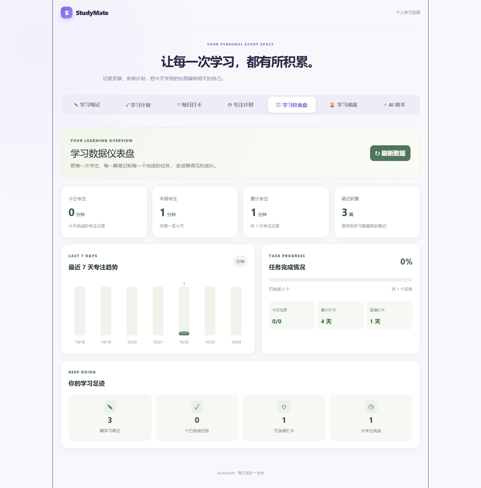

# StudyMate — 全栈学习管理平台

StudyMate 是一个面向个人学习场景的全栈学习管理平台，帮助用户管理学习笔记、规划学习任务、记录每日打卡，并通过专注计时与学习统计追踪学习进度。

项目采用 **React + TypeScript** 构建前端，使用 **Python + FastAPI** 构建后端，并通过 **SQLite + SQLAlchemy** 实现学习数据的持久化存储。

本项目主要用于实践前后端分离开发、REST API 设计、数据库操作、自动化测试和持续集成。

## 项目预览

### 学习统计仪表盘



StudyMate 提供学习笔记、任务管理、每日打卡、专注计时和学习统计等功能，帮助用户记录学习过程并追踪学习进度。

## 项目功能

### 1. 学习笔记管理
- 新增、查看、编辑和删除学习笔记
- 支持笔记搜索和分类管理
- 使用 SQLite 持久化保存笔记数据

### 2. 学习任务管理
- 创建和管理个人学习任务
- 切换任务完成状态
- 支持任务查询与筛选

### 3. 每日学习打卡
- 记录每日学习情况
- 通过打卡日历查看学习记录
- 统计累计打卡与连续打卡情况

### 4. 专注计时
- 使用计时功能辅助专注学习
- 记录学习时段，为学习统计提供数据

### 5. 学习统计仪表盘
- 汇总学习相关数据
- 展示学习进度与统计信息

### 6. 成就徽章
- 展示学习过程中的阶段性成果

> 说明：具体功能、统计口径和成就解锁规则以当前代码实现为准。

## 技术栈

| 模块 | 技术 |
| --- | --- |
| 前端框架 | React |
| 开发语言 | TypeScript、Python |
| 前端构建工具 | Vite |
| 页面样式 | CSS |
| 后端框架 | FastAPI |
| 数据库 ORM | SQLAlchemy |
| 数据库 | SQLite |
| 自动化测试 | pytest、FastAPI TestClient |
| 持续集成 | GitHub Actions |
| 版本控制 | Git |
| 代码托管 | GitHub |

## 项目结构

```text
StudyMate/
├── main.py
├── tests/
│   ├── test_notes.py
│   └── test_tasks.py
├── frontend/
│   ├── src/
│   ├── public/
│   └── package.json
├── screenshots/
│   └── dashboard.png
├── .github/
│   └── workflows/
│       └── tests.yml
├── README.md
└── studymate.db
```

> `studymate.db` 为本地运行时使用的 SQLite 数据库文件。数据库文件、Python 虚拟环境、`node_modules` 和构建产物不应作为普通源代码提交。

## 环境要求

开始运行项目前，请准备：

- Python 3.13（或经项目验证兼容的版本）
- Node.js 和 npm
- Git

## 本地运行

前端和后端需要分别启动，并保持各自的终端运行。

### 1. 获取项目代码

```powershell
git clone https://github.com/miao-wuwu/StudyMate.git
cd StudyMate
```

如果仓库是私有的，需要先获得访问权限。

### 2. 安装并启动后端

在项目根目录 `StudyMate` 中打开 PowerShell：

```powershell
python -m venv .venv
.\.venv\Scripts\Activate.ps1
python -m pip install fastapi "uvicorn[standard]" sqlalchemy pytest httpx
python -m uvicorn main:app --reload
```

后端启动后，可访问：

- 后端地址：http://127.0.0.1:8000
- API 文档：http://127.0.0.1:8000/docs

### 3. 安装并启动前端

另开一个终端，进入前端目录：

```powershell
cd frontend
npm install
npm run dev
```

根据终端输出打开 Vite 提供的本地开发地址，通常为：

http://localhost:5173/

### 4. 检查前端生产构建

在 `frontend` 目录执行：

```powershell
npm run build
```

如果构建成功，说明前端代码通过了当前构建流程的检查。

## 自动化测试

项目使用 pytest 和 FastAPI TestClient 对后端 API 进行自动化测试。

目前已编写的测试包括：

- 笔记 API：创建、查询、搜索、编辑和删除，以及不存在的笔记处理
- 任务 API：创建、查询、切换完成状态、删除和空白标题校验

运行全部测试：

```powershell
python -m pytest tests -v
```

测试使用独立的临时数据库，避免测试数据污染日常使用的学习记录。

项目通过 GitHub Actions 自动执行测试工作流，帮助发现代码修改引入的问题。

## 数据存储

项目使用 SQLite 保存学习数据，并通过 SQLAlchemy 操作数据库。

本地数据库文件通常位于项目根目录下的 `studymate.db`。首次运行时，后端会根据数据库初始化逻辑创建所需的数据表。

数据库表结构和初始化行为以当前后端模型代码为准。

## 当前开发状态

目前已实现或已验证的内容包括：

- 前后端分离架构
- React + TypeScript 前端
- FastAPI 后端及 API 文档
- 学习笔记的新增、查询、编辑、删除与搜索
- SQLite 数据持久化
- 学习任务管理
- 每日学习打卡
- 学习统计仪表盘
- 专注计时与成就界面
- 笔记和任务 API 自动化测试
- Git 版本管理与 GitHub Actions 持续集成

## 后续改进方向

- 增加用户注册、登录和个人数据隔离
- 扩充后端接口测试及前端功能测试
- 完善输入校验、异常处理与用户反馈
- 优化移动端适配和页面交互体验
- 探索线上部署方案

以上为后续改进方向，不代表这些功能已经完成。

## 项目目的

通过开发 StudyMate，实践和巩固：

- 前后端分离架构设计
- REST API 设计与调用
- Python 后端开发
- React 与 TypeScript 前端开发
- 关系型数据库与 ORM 操作
- 前端状态管理
- 自动化测试与持续集成
- Git 版本控制和 GitHub 项目管理
