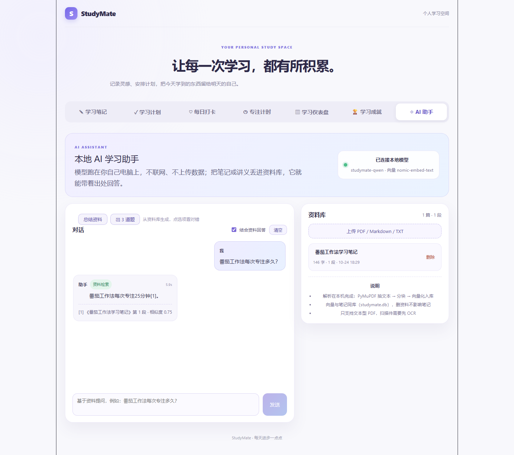

# StudyMate

一个面向个人学习的全栈平台：笔记、任务、打卡、专注计时、统计与成就徽章，外加一个**完全跑在本机、不联网、零成本**的 AI 学习助手（RAG）。

前端 React 19 + TypeScript + Vite，后端 FastAPI + SQLAlchemy + SQLite，AI 侧用 Ollama 跑 Qwen2.5-3B 与 nomic-embed-text，向量直接落在同一个 SQLite 里。

**这个项目想回答的问题**：

- 一个没有任何云服务的个人项目，能不能把「大模型 + 私有资料」做成本地可用的形态？—— 能，30 秒内起服务，问答带出处，全程离线。
- 小模型（3B）的能力边界在哪？—— 有实测数据：33 题端到端评估，Top-1 检索命中 58%，关键词覆盖 85%，出题结构 100% 合法但仍有歧义。
- 怎么让「能跑」变成「可信」？—— 51 个后端测试、GitHub Actions、3 层解析护栏、可复现的评估脚本。

---

## 目录

- [功能](#功能)
- [项目预览](#项目预览)
- [技术栈](#技术栈)
- [快速开始](#快速开始)
- [项目结构](#项目结构)
- [AI 学习助手](#ai-学习助手)
- [效果评估](#效果评估)
- [设计要点](#设计要点)
- [测试与 CI](#测试与-ci)
- [已知限制与后续计划](#已知限制与后续计划)

---

## 功能

| 模块 | 说明 |
| --- | --- |
| 学习笔记 | 增删改查、按关键词搜索、按分类筛选 |
| 学习计划 | 任务增删改查、切换完成状态、按状态/分类筛选 |
| 每日打卡 | 每天一次（数据库唯一约束兜底）、日历视图、累计与连续天数 |
| 专注计时 | 15 / 25 / 45 / 60 分钟预设（接口支持 1–240），按 `endAt` 时间戳计时，结束写入学习时段 |
| 学习仪表盘 | 汇总打卡、专注时长、任务完成数与笔记数 |
| 成就徽章 | 10 项徽章，按打卡/专注/任务/笔记数据自动点亮，未解锁显示进度 |
| **AI 学习助手** | 本地大模型多轮对话；上传 PDF/Markdown/TXT 后基于资料问答并标注出处；一键总结要点；按资料出选择题并即时判对错 |

## 项目预览

AI 助手（带出处的资料问答）：



学习统计仪表盘：


## 技术栈

| 层 | 选型 |
| --- | --- |
| 前端 | React 19、TypeScript 6、Vite 8、原生 CSS（无 UI 框架、无状态库） |
| 后端 | Python 3.13、FastAPI、Pydantic、SQLAlchemy 2 |
| 存储 | SQLite（业务数据与向量同库） |
| AI | Ollama · Qwen2.5-3B-Instruct（Q4_K_M）、nomic-embed-text（768 维） |
| 文档解析 | PyMuPDF，numpy（余弦相似度） |
| 测试 / CI | pytest、FastAPI TestClient、GitHub Actions |

## 快速开始

### 环境要求

- Python 3.13（或经项目验证兼容的版本）
- Node.js 18+ 与 npm
- （可选，只有用 AI 功能才需要）Ollama，以及约 2.5 GB 磁盘放模型

### 1. 后端

```powershell
git clone https://github.com/miao-wuwu/StudyMate.git
cd StudyMate
python -m venv .venv
.\.venv\Scripts\Activate.ps1
python -m pip install fastapi "uvicorn[standard]" sqlalchemy pytest httpx numpy pymupdf python-multipart
python -m uvicorn main:app --reload
```

后端跑在 http://127.0.0.1:8000 ，接口文档在 http://127.0.0.1:8000/docs 。

### 2. 前端

另开一个终端：

```powershell
cd frontend
npm install
npm run dev
```

浏览器打开 http://localhost:5173/ （用 `localhost`，不要用 `127.0.0.1`，CORS 白名单里没有它）。

任意面板都可以用 `?page=` 深链接直达，例如 http://localhost:5173/?page=ai 。

### 3. AI 助手（可选）

```powershell
# 准备好推理模型与向量模型
ollama pull qwen2.5:3b            # 约 1.9 GB；若用本地 GGUF，则改为 ollama create studymate-qwen -f <Modelfile>
ollama pull nomic-embed-text      # 约 274 MB

# 需要改配置时，从模板复制一份（默认值即可在本机零成本运行）
copy .env.example .env
```

模型名要和 `.env` 里的 `OLLAMA_MODEL` 对上：默认配置写的是 `studymate-qwen`（用 GGUF 导入的名字），如果你直接 `ollama pull qwen2.5:3b`，把 `.env` 里的 `OLLAMA_MODEL` 改成 `qwen2.5:3b` 即可。

前端切到「AI 助手」标签，右上角徽标变绿（显示模型名与向量模型）即接通。不用 AI 功能的话，前两步就够，笔记/任务/打卡等全部照常工作。

## 项目结构

```text
StudyMate/
├── main.py                     # FastAPI 入口：13 个业务接口、4 张表、CORS
├── ai/                         # AI 模块（与业务代码解耦，可单独删掉）
│   ├── config.py               # .env 解析与全部可调参数
│   ├── llm.py                  # Ollama / DeepSeek 双 provider、历史裁剪、embedding
│   ├── store.py                # documents / chunks 两张表、分块检索、向量更新
│   ├── rag.py                  # 文本抽取（PDF/MD/TXT）→ 分块 → 检索 → 带出处回答
│   ├── study.py                # 摘要与选择题生成（含解析护栏）
│   └── router.py               # /ai/* 路由
├── tests/                      # 51 个测试：业务 CRUD、AI 各层、历史裁剪、前缀
├── scripts/
│   ├── eval_ai.py              # 33 题端到端评估，产出 docs/eval-report.md
│   └── reindex_embeddings.py   # 换 embedding 模型后重算全部向量
├── docs/eval-report.md         # 评估报告（汇总表 + 逐题明细）
├── frontend/                   # React + TS + Vite（无 UI 框架、无状态库）
│   └── src/
│       ├── App.tsx             # 布局、页面切换、笔记与任务两个面板、数据加载
│       ├── TimerPanel.tsx      # 专注计时（endAt 时间戳 + 防重复保存）
│       ├── CheckinPanel.tsx    # 每日打卡与日历
│       ├── DashboardPanel.tsx  # 学习仪表盘（并行拉四类数据）
│       ├── AchievementsPanel.tsx # 成就徽章与解锁进度
│       ├── AiPanel.tsx         # AI 助手：对话 / 资料库 / 总结 / 出题
│       └── *.css               # 原生 CSS，按面板拆分
├── .github/workflows/tests.yml # CI：push / PR 跑全量 pytest
├── .env.example                # AI 模块配置模板
└── studymate.db                # 本地运行时数据库（不入库）
```

## AI 学习助手

### 工作流

```text
上传 PDF/MD/TXT
  → PyMuPDF / 文本读取，正则压空白
  → 按「段 → 句」贪心分块（500 字，重叠 80 字）
  → nomic-embed-text 逐块向量化（带 search_document: 前缀）
  → 存进 SQLite 的 chunks 表（float32 BLOB，同库不同表）

提问
  → 问题向量化（带 search_query: 前缀）
  → numpy 暴力余弦相似度取 top-4
  → 拼上下文，要求模型标注来源
  → 返回 answer + sources（标题、块序号、相似度）
```

资料库为空时，`/ai/ask` 自动退化成普通对话（`mode: "chat"`）；有资料时返回 `mode: "rag"`，答案里带 `[1] [2]` 并能列出每一条的出处。

### 接口

| 方法 | 路径 | 说明 |
| --- | --- | --- |
| GET | `/ai/health` | 探活：模型名、向量模型、资料库统计 |
| POST | `/ai/chat` | 多轮对话（历史自动裁剪） |
| POST | `/ai/ask` | 基于资料提问，返回 `answer` + `sources` |
| POST | `/ai/summary` | 总结资料：`summary` + `points` 列表 |
| POST | `/ai/quiz` | 出选择题：题干、四选项、答案、解析 |
| GET / POST | `/ai/documents` | 资料列表 / 提交纯文本入库 |
| POST | `/ai/documents/upload` | 上传文件入库（`.txt/.md/.markdown/.pdf`） |
| DELETE | `/ai/documents/{id}` | 删除资料（连带删除其文本块） |
| POST | `/ai/search` | 只检索，返回命中的文本块与相似度 |

### 模型与性能

本机（RTX 4060 Laptop 8 GB + Qwen2.5-3B Q4_K_M）实测：

- 显存占用约 **2.4 GB**，生成速度约 **12 tokens/s**
- 首次加载约 30 秒；`KEEP_ALIVE`（默认 5m）到期后自动卸载，不常驻占卡
- 显存不足时 Ollama 会把部分层放到 CPU（`ollama ps` 可见），只是变慢，不会崩

### 可配置项

复制 `.env.example` 为 `.env`，全部有可用默认值：

| 变量 | 默认 | 说明 |
| --- | --- | --- |
| `LLM_PROVIDER` | `ollama` | 也可切 `deepseek`（需要 `DEEPSEEK_API_KEY`） |
| `OLLAMA_MODEL` / `OLLAMA_EMBED_MODEL` | `studymate-qwen` / `nomic-embed-text` | 推理与向量模型 |
| `NUM_CTX` / `TEMPERATURE` | `4096` / `0.3` | 上下文窗口与随机性 |
| `KEEP_ALIVE` | `5m` | 空闲多久卸载模型（控制显存） |
| `CHUNK_SIZE` / `CHUNK_OVERLAP` / `TOP_K` | `500` / `80` / `4` | 分块与检索参数 |
| `LLM_HISTORY_MAX_CHARS` / `LLM_HISTORY_MAX_MESSAGES` | `6000` / `20` | 多轮历史预算，超出后丢弃最早的对话 |

## 效果评估

`scripts/eval_ai.py` 用固定题集跑端到端流程，结果写入 [docs/eval-report.md](docs/eval-report.md)：

```powershell
.venv\Scripts\python.exe scripts\eval_ai.py
```

脚本使用临时数据库，不污染 `studymate.db`。**6 篇语料 / 33 道问答 / 3 轮出题**的实测结果：

| 指标 | 结果 |
| --- | --- |
| 检索命中率（top-4 含正确文档） | 85% |
| **Top-1 命中率**（相似度最高即正确文档） | **58%** |
| 回答关键词覆盖率 | 85% |
| 检索与关键词同时满足 | 85% |
| 平均问答延迟 | 6.3 s |
| 出题结构合法率（4 选项且答案合法） | 100% |
| 出题重复（同题干） | 0 / 9 |

两点必须说清楚，否则这些数字会误导：

1. **语料只有 6 篇、每篇 1 个文本块，`TOP_K=4`**，所以「top-4 命中 85%」意义有限，真正有信息量的是 **Top-1 58%**。要把它当成通用能力指标是不成立的。
2. 33 题里没命中的 5 题集中在《数据库索引》与少数边界问法，模型的表现是回答「资料中没有相关内容」而不是编造——这符合 RAG 的预期，但也说明召回还有空间。

一个实测出来的细节：`nomic-embed-text` 按任务前缀训练，入库要加 `search_document: `、检索要加 `search_query: `。不加前缀时关键词覆盖率只有 **76%**，加上后升到 **85%**。换 embedding 模型或改前缀策略后，用下面这条命令重算已有向量：

```powershell
.venv\Scripts\python.exe scripts\reindex_embeddings.py
```

## 设计要点

几个面试常被追问的地方，以及当时的取舍：

- **打卡的幂等性交给数据库**。`checkins` 表对 `date` 加唯一约束（`uq_checkin_date`），重复打卡在插入时就会失败，不需要先查再插，也就不存在并发下的检查-插入竞争。
- **写学习时段时做三重校验**：开始时间必须早于结束时间、任务外键必须存在、任务标题用库里查到的值覆盖前端传来的值——避免历史记录因为任务改名而失真。
- **计时器不信任 `setInterval` 的累加**。用 `endAt` 时间戳现算剩余秒数（`Math.round((endAt - Date.now()) / 1000)`），每 250 ms 刷新一次，这样切后台、锁屏、系统睡眠都不会让计时漂移；再用 `savedRef` 保证同一段计时只保存一次（React StrictMode 下 effect 会跑两次）。
- **AI 的三层护栏**。prompt 层要求「每题考不同知识点、禁止只有语序差异的选项」；解析层丢弃答案不在 A/B/C/D、或选项少于两个的题目；最后按题干与选项集去重。这样即使 3B 模型跑偏，也不会把明显坏的题返回给前端。
- **多轮历史必须裁剪**。全量历史迟早撑爆 `num_ctx`，所以按 6000 字符 / 20 条预算从最早开始丢弃，把提示语并进 system（不额外多一条），并保留最后一条用户消息。
- **向量与业务数据同库**。单独引向量库（FAISS/Chroma）在个人规模上没有收益，`chunks` 表存 float32 BLOB 后 numpy 点积足够快，且备份、迁移只要拷一个 `.db` 文件。
- **测试隔离靠 fixture**。每个用例用 `tmp_path` 建临时库 + `app.dependency_overrides` 替换 `get_db`，测试之间互不影响，也不会碰日常数据。

## 测试与 CI

```powershell
.venv\Scripts\python.exe -m pytest tests -v
```

| 测试文件 | 覆盖内容 |
| --- | --- |
| `test_notes.py` / `test_tasks.py` | 笔记与任务的 CRUD、搜索、切换完成、404 与 422 校验 |
| `test_ai.py` | health 健壮性、chat 正常与上游错误、入参校验、原有接口不受影响 |
| `test_rag.py` | 分块边界、入库检索、维度不符跳过、上传接口、空库退化为 chat |
| `test_study.py` | JSON 解析容错、要点结构兼容、摘要/出题端点、非法题目过滤 |
| `test_history.py` | 历史裁剪：system 合并、条数上限、单条截断、真实 `chat()` 生效 |
| `test_embed_prefix.py` | 向量任务前缀：document / query 分别加前缀、其它模型不加 |

合计 **51 passed**。GitHub Actions（`.github/workflows/tests.yml`）在 push 与 PR 到 `master` 时用 Python 3.13 跑全量测试。

## 已知限制与后续计划

**已知限制（都是实测发现的真实短板）**

- 中文检索依赖 `nomic-embed-text`，Top-1 只有 58%；换 `bge-m3` 预期明显提升，接口与前端不用改。
- 3B 模型出题仍可能出现「多个选项都说得通」；换 7B（约 4.7 GB）会稳，但生成速度降到一半左右。
- 资料只支持 `.txt/.md/.pdf`，**不支持 docx**；扫描版 PDF 没有 OCR。
- 没有用户系统，单机单用户；前端无路由，刷新页面需要靠 `?page=` 深链接。
- 检索是暴力余弦，语料上万块之后才需要担心性能。

**后续计划**

- 用户注册与数据隔离、前端功能测试、Docker 化与线上部署
- 换 `bge-m3` 向量模型；评估题集扩到 50 题以上并固定语料版本
- 支持 docx 解析；把出题改成「先列考点再出题」两段式，降低歧义

以上计划未实现，写在这里是为了让「已完成」与「计划中」的边界清晰。
